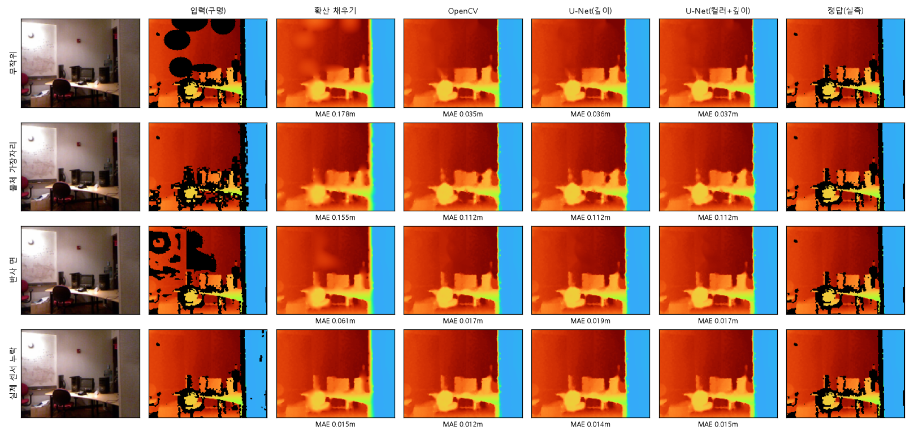
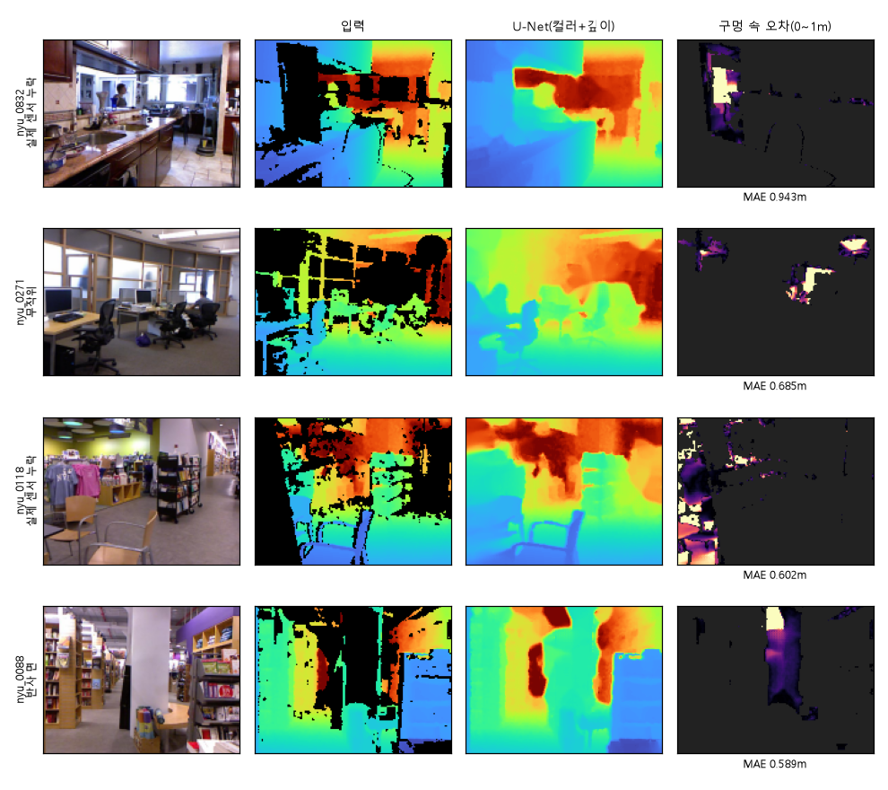

# depth-fill-robot

### 로봇 카메라가 못 본 곳 채우기

로봇은 **깊이 카메라**로 물건까지의 거리를 봅니다. 그런데 유리컵·창문처럼 투명한 것, 금속처럼 반짝이는 면, 물체 가장자리에서는 거리를 못 재고 **빈칸(구멍)**이 생깁니다. 빈칸을 그대로 두면 로봇이 "거기엔 아무것도 없다"고 착각해 물건을 잘못 집거나 부딪힐 수 있습니다.

이 프로젝트는 그 빈칸을 채우는 방법들을 **같은 시험지로 채점해서 어떤 방법이 어디서 틀리는지** 밝히고, 기존 방법보다 덜 틀리는 모델을 직접 만들었습니다. 채점은 센서가 제대로 잰 곳을 일부러 가린 뒤 원래 값과 비교하는 방식이라 정답을 알고 잴 수 있습니다. 완성한 모델은 작은 API로 감싸고, 품질이 나빠지면 실패하는 자동 시험까지 붙였습니다.

> **결과 한 줄**: 실제 센서 데이터(NYU Depth v2 시험 654장)에서, Telea로 먼저 채우고 보정값만 배우는 작은 U-Net이 가장 강한 기준선(OpenCV Telea)보다 **구멍 유형 네 가지 모두에서** 오차가 낮았습니다(반사 면 −22%, 무작위 −12%, 실제 센서 누락 −4%, 가장자리 −2%. 장면 짝 비교 95% 구간이 모두 0 아래). 처음 설계(깊이를 통째로 맞히기)는 Telea를 넘지 못했고, 컬러를 더해도 나아지지 않았습니다. 둘 다 그대로 적었습니다.


<sub>시험 장면 3개(고르지 않고 뷰어와 같은 번호). 흰 선 안이 채운 곳, 3D의 주황 점이 채운 부분. 첫 장면은 U-Net이 Telea에 진 장면이라 그대로 두었습니다.</sub>

- **소개 페이지**: [docs/index.html](docs/index.html) — 직접 돌려 보는 전/후 비교·3D 점, 결과 그래프, 실패 기록 (`cd docs; python -m http.server` 후 `http://localhost:8000`)
- **한 번에 시연**: `python scripts/demo.py` — 데이터 → 구멍 → 비교 → API → 품질 기준(통과/일부러 실패) → 단위 시험 (약 100초)
- 판단 기록: [docs/decision-log.md](docs/decision-log.md) — 모든 선택의 이유, 잘 안 된 시도, 버그
- 구조 규칙: [docs/STRUCTURE.md](docs/STRUCTURE.md) · 시작 안내: [docs/HOME_START.md](docs/HOME_START.md)

## 1. 문제

깊이 카메라(RGB-D 센서)는 반사되는 면, 투명한 물체, 물체의 가장자리에서 값이 비는 일이 많습니다. 빈 영역이 있으면 로봇이 물체의 위치와 높이를 잘못 추정할 수 있습니다. 어떤 보완 방법이 **어떤 종류의 구멍에서 좋고 어디서 틀리는지**를 알면 방법을 고르고 고칠 근거가 생깁니다.

## 2. 무엇을 만들었나

| 부분 | 내용 |
|---|---|
| 데이터 | NYU Depth v2 labeled 1,449장, **공식 학습 795 / 시험 654 분할**(같은 방이 양쪽에 섞이지 않음). 120x160으로 줄여 사용 |
| 구멍 생성기 | 무작위 덩어리 · 물체 가장자리 · 반사 면(밝고 매끈한 곳) · **실제 센서 누락**(다른 장면의 실제 빈 모양을 빌려 옴). 시드 고정 |
| 평가 하네스 | 모든 방법에 같은 장면·같은 구멍. 오차는 두 기준: 채운 정답 전체, **센서가 실제로 잰 픽셀만**(결론은 이쪽) |
| 기준선 | 안 채움 · 평균 · 확산(주변 평균 반복) · OpenCV Telea |
| 모델 | 작은 U-Net(193만 파라미터) A: 깊이만 · B: 컬러+깊이. **가려 맞히기** 학습, 손실은 실측 픽셀에서만 |
| 분석 | 유형별 표, 장면 짝 비교(부트스트랩 95% 구간), 실패 사례 그림, 학습 곡선 |
| 뷰어 | 전/후 슬라이더, 끌어서 돌리는 3D 점(채운 부분 주황색) |
| (선택) 서비스 | Flask API `POST /v1/fill`(16비트 PNG mm 입출력), 응답 형식 시험, **품질 기준 시험**(Telea보다 나쁘면 실패) |

### 왜 "실측 픽셀만"으로 재나
NYU의 정답 깊이(`depths`)는 센서가 못 잰 곳을 **이미 알고리즘으로 채운 값**입니다. 그대로 쓰면 "다른 알고리즘이 채운 값을 맞히는지"를 재게 됩니다. 그래서 학습 손실과 결론 지표 모두 센서가 실제로 잰 픽셀(`rawDepths > 0`)에서만 계산했습니다. 방법에 넘기는 입력도 원래 못 잰 곳은 비워서 넘깁니다(실제 센서와 같은 조건).

## 3. 결과 (시험 654장, 구멍 비율 약 15%, 시드 42)

**MAE실측(m)**, 낮을수록 좋음. 전체 표(RMSE, 채운 정답 기준 포함)는 `python scripts/run_eval.py`로 다시 만들 수 있습니다.

| 구멍 유형 | 평균 채우기 | 확산 | OpenCV Telea | U-Net 깊이 1차 | U-Net 깊이 2차 | U-Net 컬러 2차 |
|---|---|---|---|---|---|---|
| 물체 가장자리 | 0.889 | 0.121 | 0.107 | 0.155 | **0.105** | 0.105 |
| 무작위 | 0.796 | 0.228 | 0.148 | 0.165 | **0.130** | 0.132 |
| 반사 면 | 0.813 | 0.115 | 0.072 | 0.099 | **0.056** | 0.057 |
| 실제 센서 누락 | 0.802 | 0.108 | 0.076 | 0.127 | 0.073 | **0.073** |

- **1차**(구멍 속 깊이를 통째로 맞히기)는 네 유형 모두 Telea보다 나빴습니다.
- **2차**(Telea로 먼저 채운 깊이를 입력으로 주고 **보정값만** 학습)만 바꿔서 네 유형 모두 Telea를 넘었습니다. 같은 장면끼리 비교하면 이긴 장면이 84~88%, 실제 센서 누락은 60~64%입니다.
- **컬러를 더한 효과는 확인되지 않았습니다**(컬러 모델이 나은 장면 38~49%). 원인 추정과 다음 시도는 판단 기록에 있습니다.




### 실패 사례


오차가 큰 장면은 모두 구멍이 **창문·유리·먼 공간처럼 깊이가 갑자기 멀어지는 곳을 넓게 덮은 경우**였습니다. 구멍 둘레가 가까운 물체라 가까운 깊이로 이어 붙였지만 정답은 그 뒤의 먼 공간이었습니다(0.6~0.9m 오차). 주변 값을 이어 붙이는 방식의 한계로, 로봇에 쓰려면 이런 곳을 믿지 않도록 **불확실도**를 함께 내야 합니다.

### 시연 (터미널 실제 출력)


품질 기준 시험은 결론과 같이 **시험 654장 전체**로 판정합니다. 앞 60장만 쓰면 실제 센서 누락 유형에서 U-Net이 집니다(0.0650m 대 Telea 0.0633m). 이긴 장면이 60%인 유형이라 표본이 작으면 뒤집히기 때문입니다.

### 이 과정에서 잡은 버그
첫 평가에서 OpenCV Telea가 평균 채우기보다 나빴습니다(0.9m). 구멍 속 평균은 맞는데 픽셀마다 값이 튀는 것을 보고, 이 OpenCV 버전에서 **float32 깊이를 넣으면 Telea가 깨진다**는 것을 확인했습니다. 밀리미터 `uint16`으로 넣도록 고쳤고(0.905m → 0.072m), 같은 일이 다시 생기면 잡히도록 시험을 더했습니다. 이 버그를 못 잡았다면 기준선이 실제보다 훨씬 약하게 나와 "모델이 기준선을 크게 이겼다"는 잘못된 결론을 냈을 것입니다.

## 4. 범위와 한계

- **실제 로봇을 쓰지 않았습니다.** 실제 센서(Kinect)로 찍은 공개 데이터입니다.
- 무작위·가장자리·반사 구멍은 사람이 정한 규칙이라 실제 누락과 다를 수 있습니다. 그래서 실제 누락 모양을 빌려 오는 유형을 더했고, 이 유형에서 개선 폭이 가장 작았습니다.
- 120x160으로 줄여서 작업했습니다. 원본 해상도의 세밀한 경계는 평가하지 않았습니다.
- 모델 성능으로 경쟁하지 않습니다. 작은 모델로 **설계, 공정한 평가, 분석**을 보이는 것이 목적입니다.

## 5. 실행 방법

```powershell
powershell -ExecutionPolicy Bypass -File scripts\setup.ps1      # 가상환경, 패키지
# PyTorch(GPU)는 docs/HOME_START.md 3단계
# data/에 nyu_depth_v2_labeled.mat(약 2.8GB)와 splits.mat을 받아 둔다
.\.venv\Scripts\python scripts\prepare_nyu.py                    # 잘라 줄이기(약 30초)
.\.venv\Scripts\python scripts\run_eval.py --methods nofill meanfill diffusion opencv_telea
.\.venv\Scripts\python scripts\train_unet.py --model unet_depth  # RTX 3060 Ti에서 약 5분
.\.venv\Scripts\python scripts\train_unet.py --model unet_rgbd
.\.venv\Scripts\python scripts\run_eval.py                       # 모든 방법 비교표
.\.venv\Scripts\python scripts\quality_gate.py --model unet_depth   # 시험 654장, 기준선보다 나쁘면 종료 코드 1
.\.venv\Scripts\python scripts\demo.py                           # 처음부터 끝까지 시연(약 100초)
.\.venv\Scripts\python scripts\make_figures.py                   # 그림, 뷰어 데이터
.\.venv\Scripts\python scripts\make_demo_gif.py                  # README 맨 위 GIF
.\.venv\Scripts\python -m pytest                                 # 시험 17개(데이터 없이 돈다)
```

API: `python -m depthfill.api.app` → `POST http://localhost:8000/v1/fill` `{"depth_png": <16비트 PNG(mm) base64>, "rgb_png": <선택>, "method": "unet_depth"}`

## 6. 구조

```
configs/default.toml        숫자는 모두 여기(해상도, 구멍 비율, 학습 설정)
src/depthfill/
  data/      합성 장면, NYU 로더(실측 픽셀 마스크 포함)
  holes/     구멍 4종
  methods/   기준선, U-Net(torch는 이 파일에서만), 이름 등록부
  eval/      지표(구멍 영역만), 평가 하네스
  api/       Flask 서비스(웹 프레임워크는 여기서만)
scripts/     준비, 학습, 평가, 품질 기준, 그림
tests/       데이터 없이 도는 시험(구멍, 지표, 하네스, NYU 로더, API)
docs/        소개 페이지(index.html), 판단 기록, 구조 규칙, 그림, 뷰어
```

## 7. 실행 환경

Windows 11 · Python 3.12.10 · PyTorch 2.11.0+cu128 · NVIDIA GeForce RTX 3060 Ti (VRAM 8GB). 모델 하나 학습 약 5분(60에폭).

## 8. 진행 상태

- [x] 계획 작성
- [x] 환경 (GPU 확인)
- [x] 데이터 · 구멍 생성기 (실제 센서 누락 유형 추가)
- [x] 기준선 · 평가 하네스 (Telea 입력 버그 수정)
- [x] 모델 A · 모델 B · 개선 1회 (1차 실패 → 2차 잔차 학습)
- [x] 뷰어 · 실패 사례 분석
- [x] (선택) 모델 서비스 API · 응답 형식 시험 · 품질 기준 시험
- [x] 시연 스크립트 · 시연 GIF · 소개 페이지
- [ ] 다음: 불확실도 출력, 컬러 경로 분리, 원본 해상도 평가
