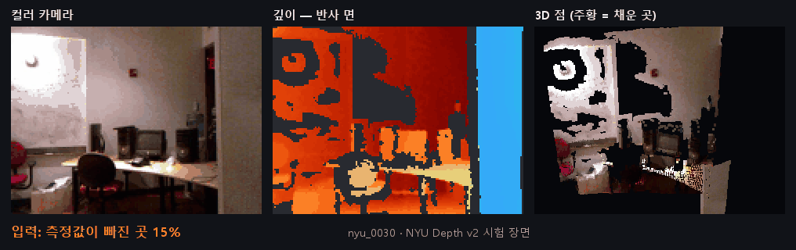
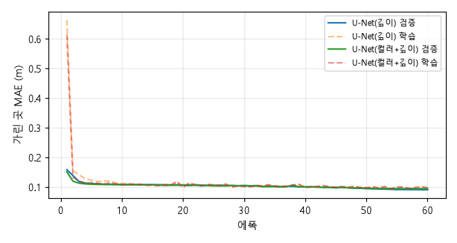
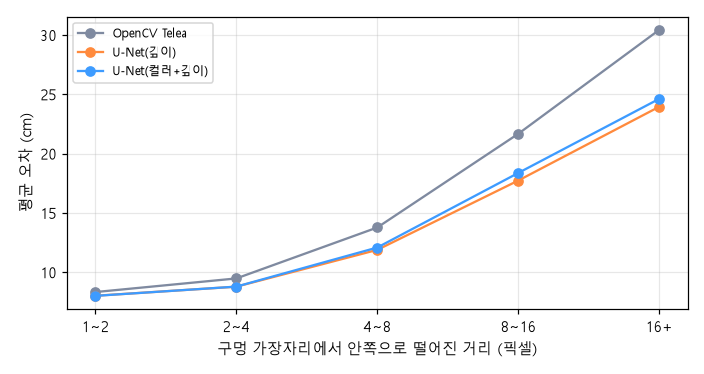
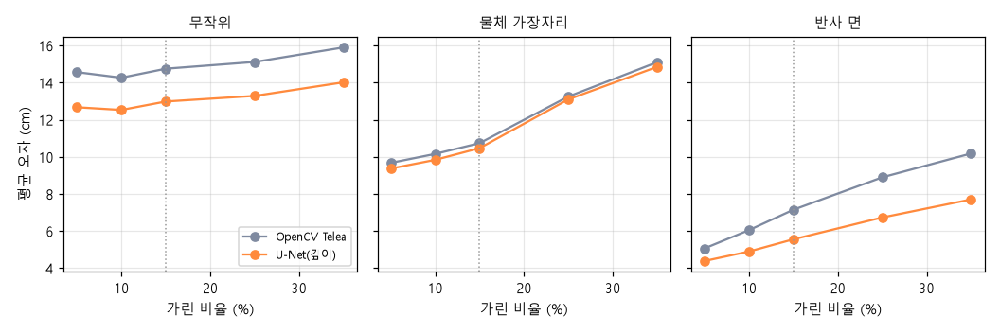
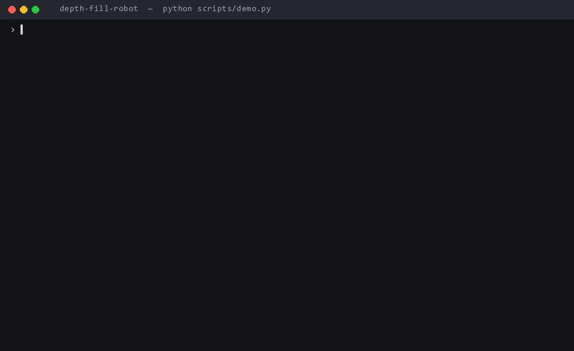

# depth-fill-robot

### 로봇 카메라가 못 본 곳 채우기

로봇은 **깊이 카메라**로 물건까지의 거리를 봅니다. 그런데 유리컵·창문처럼 투명한 것, 금속처럼 반짝이는 면, 물체 가장자리에서는 거리를 못 재고 **빈칸**(구멍)이 생깁니다. 빈칸을 그대로 두면 로봇이 "거기엔 아무것도 없다"고 착각해 물건을 잘못 집거나 부딪힐 수 있습니다.

이 프로젝트는 그 빈칸을 채우는 방법들을 **같은 시험지로 채점해서 어떤 방법이 어디서 틀리는지** 밝히고, 기존 방법보다 덜 틀리는 모델을 직접 만들었습니다. 채점은 센서가 제대로 잰 곳을 일부러 가린 뒤 원래 값과 비교하는 방식이라 정답을 알고 잴 수 있습니다. 완성한 모델은 작은 API로 감싸고, 품질이 나빠지면 실패하는 자동 시험까지 붙였습니다.

> **결과 한 줄**: 실제 센서 데이터(NYU Depth v2 시험 654장)에서, Telea로 먼저 채우고 보정값만 배우는 작은 U-Net이 가장 강한 기준선(OpenCV Telea)보다 **구멍 유형 네 가지 모두에서** 오차가 낮았습니다. 학습을 시드 3개로 반복하면 **평균 반사 면 −13%, 무작위 −6%, 실제 센서 누락 −2%, 가장자리 −2%**이고, 세 번 모두 네 유형에서 Telea보다 낮았습니다(대표 모델은 그중 가장 잘 나온 시드 42로 −22%/−12%/−4%/−2%). 빈칸 깊숙한 곳(−21%)과 로봇 팔이 닿는 1.5m 안쪽(−12%)에서 이득이 컸고, 5m 넘는 먼 곳은 차이가 없었습니다. 처음 설계(깊이를 통째로 맞히기)는 Telea를 넘지 못했고, 컬러를 더해도 나아지지 않았습니다. 모두 그대로 적었습니다.



<sub>시험 장면 3개(고르지 않고 뷰어와 같은 번호). 흰 선 안이 채운 곳, 3D의 주황 점이 채운 부분. 첫 장면은 U-Net이 Telea에 진 장면이라 그대로 두었습니다.</sub>

- **직접 눌러 보기**: **https://j75390.github.io/depth-fill-robot/** — 장면·구멍·방법을 골라 전/후 비교, 3D 점 돌려 보기, 결과 그래프, 실패 기록 (원본: [docs/index.html](docs/index.html))
- **한 번에 시연**: `python scripts/demo.py` — 데이터 → 구멍 → 비교 → API → 품질 기준(통과/일부러 실패) → 단위 시험 (약 100초)
- 판단 기록: [docs/decision-log.md](docs/decision-log.md) — 모든 선택의 이유, 잘 안 된 시도, 버그
- 구조 규칙: [docs/STRUCTURE.md](docs/STRUCTURE.md) · 시작 안내: [docs/HOME_START.md](docs/HOME_START.md)

## 1. 왜 만들었나

**"몇 명인지는 아는데, 얼마나 붐비는지는 모른다."** 이 프로젝트는 이 질문에서 시작했습니다.

팀 프로젝트 [white-eyes](https://github.com/white-eyes1)에서 드론·CCTV 영상으로 사람을 찾아 세고 혼잡 단계를 판단하는 관제 서비스를 만들었습니다(YOLOv8 + VisDrone 가중치, Flask 분석 서버, Spring 앱 서버). 저는 혼잡 단계 그래프와 분석 쪽을 맡았는데, 테스트 영상을 돌려 보다가 이상한 점을 봤습니다. 같은 광장을 찍었는데 드론이 높이 떠 있을 때와 낮게 내려왔을 때 화면 속 사람 크기가 완전히 달랐습니다. 사람 수는 잘 세는데, **그 사람들이 실제로 몇 미터 안에 모여 있는지**는 영상만으로 알 수 없었습니다. 혼잡이란 결국 "1㎡에 몇 명이냐"인데, 화면에는 미터가 없었습니다. 결국 혼잡 단계는 사람 수와 화면 기준으로 정할 수밖에 없었습니다.

두 번째로 남은 건 모델을 고를 때였습니다. 군중 전용 모델과 드론 영상용 가중치를 비교했는데, 평균 점수만 보면 큰 차이가 없어 보였습니다. 그런데 높은 고도에서 점처럼 작게 찍힌 사람, 서로 겹쳐 선 사람처럼 **관제에서 정작 중요한 장면**만 따로 보면 결과가 달랐습니다. 숫자 하나로 골랐다면 틀린 선택을 할 뻔했습니다.

그래서 두 가지를 직접 해 보고 싶었습니다.
1. **화면이 아니라 실제 거리(깊이)를 다루는 것.** 드론이든 로봇이든 실제 공간에서 움직이려면 미터 단위의 거리가 필요합니다.
2. **"어디서 틀리는지"를 조건별로 재는 것.** 평균이 아니라 상황별로 쪼갠 채점표를 먼저 만들고, 모델은 그 위에서 고르는 방식입니다.

거리를 직접 재는 센서를 찾아보다가 깊이 카메라를 알게 됐고, 자료를 볼수록 이 카메라에도 약점이 있다는 걸 알았습니다. **유리·금속·물건 가장자리에서는 거리를 못 재고 빈칸이 생깁니다.** 그런데 이 빈칸을 채우는 방법들도 대부분 평균 오차 하나로 비교되고 있었습니다. white-eyes에서 겪은 문제와 똑같은 구조였습니다. 두 가지를 한 번에 해 볼 수 있는 주제라서 이걸 골랐습니다.

**왜 로봇 집기인가.** 빈칸이 가장 치명적인 곳이 로봇 집기이기 때문입니다. 로봇이 자주 다루는 물건이 하필 유리컵·페트병(빛이 통과), 금속 캔·유광 포장(빛이 튕김)입니다. 비어 있는 곳을 "아무것도 없다"로 읽으면 로봇은 허공을 집거나 물건에 부딪힙니다.

**처음 계획은 "모델로 채우고, 가상 로봇으로 집기 성공률을 올린다"였습니다**(저장소 첫 커밋의 계획서). 그런데 계획을 구체화하면서 한 가지가 걸렸습니다. 깊이 보완 모델은 보통 **평균 오차 하나**로 비교되는데, 로봇에게 중요한 건 평균이 아니라 *어디서* 틀리느냐입니다. 벽 한가운데서 2cm 틀리는 것과 컵 가장자리에서 2cm 틀리는 것은 로봇에게 전혀 다른 일입니다. 평균이 좋아져도 정작 투명한 물건 쪽이 나빠졌다면 로봇에게는 개선이 아닙니다.

**그래서 순서를 바꿨습니다.** 모델보다 먼저 "어떤 방법이 어떤 빈칸에서 얼마나 틀리는지"를 **같은 시험지로 공정하게 재는 도구**를 세우고, 그 위에서 모델을 만들기로 했습니다. 파지 시뮬레이션은 선택 과제로 내렸습니다. 채점이 틀리면 그 위에 쌓은 결론이 다 틀리기 때문입니다.

이 결정이 맞았다는 건 작업 중에 세 번 확인됐습니다.
1. **정답 자체의 함정**: 데이터셋의 "정답 깊이"는 센서가 못 잰 곳을 이미 알고리즘으로 채운 값이었습니다. 그대로 쓰면 "다른 알고리즘 흉내"를 채점하게 됩니다. → 센서가 실제로 잰 픽셀만 정답으로 쓰도록 바꿨습니다.
2. **기준선 버그**: OpenCV Telea가 평균 채우기보다 나쁘게 나왔고, 원인은 입력 형식이었습니다. 못 잡았으면 "내 모델이 기존 방법을 크게 이겼다"는 틀린 결론을 냈을 것입니다.
3. **표본 크기**: 시험 장면 앞 60장만 쓰면 "실제 센서 누락" 유형에서 결론이 뒤집혔습니다. → 판정은 항상 654장 전체로 합니다.

그리고 평균을 쪼개 보니, 로봇에게 실제로 중요한 질문("가까운 물건에서 얼마나 틀리나", "빈칸 깊숙한 곳은 어떤가", "몇 cm 넘게 틀리는 픽셀이 얼마나 되나")에 대한 답이 평균과 다르게 나왔습니다. 아래 **3-1. 더 세밀하게 잰 것**에 정리했습니다.

## 2. 무엇을 만들었나

| 부분 | 내용 |
|---|---|
| 데이터 | NYU Depth v2 labeled 1,449장, **공식 학습 795 / 시험 654 분할**(같은 방이 양쪽에 섞이지 않음). 120x160으로 줄여 사용 |
| 구멍 생성기 | 무작위 덩어리 · 물체 가장자리 · 반사 면(밝고 매끈한 곳) · **실제 센서 누락**(다른 장면의 실제 빈 모양을 빌려 옴). 시드 고정 |
| 평가 하네스 | 모든 방법에 같은 장면·같은 구멍. 오차는 두 기준: 채운 정답 전체, **센서가 실제로 잰 픽셀만**(결론은 이쪽) |
| 기준선 | 안 채움 · 평균 · 확산(주변 평균 반복) · OpenCV Telea |
| 모델 | 작은 U-Net(193만 파라미터) A: 깊이만 · B: 컬러+깊이. **가려 맞히기** 학습, 손실은 실측 픽셀에서만 |
| 분석 | 유형별 표, 장면 짝 비교(부트스트랩 95% 구간), 실패 사례 그림, 학습 곡선 |
| 뷰어 | 전/후 슬라이더, 끌어서 돌리는 3D 점(채운 부분 주황색) |
| (선택) 서비스 | Flask API `POST /v1/fill`(16비트 PNG mm 입출력), 응답 형식 시험, **품질 기준 시험**(Telea보다 나쁘면 실패) |

### 왜 "실측 픽셀만"으로 재나
NYU의 정답 깊이(`depths`)는 센서가 못 잰 곳을 **이미 알고리즘으로 채운 값**입니다. 그대로 쓰면 "다른 알고리즘이 채운 값을 맞히는지"를 재게 됩니다. 그래서 학습 손실과 결론 지표 모두 센서가 실제로 잰 픽셀(`rawDepths > 0`)에서만 계산했습니다. 방법에 넘기는 입력도 원래 못 잰 곳은 비워서 넘깁니다(실제 센서와 같은 조건).

## 3. 결과 (시험 654장, 구멍 비율 약 15%, 시드 42)

**MAE실측(m)**, 낮을수록 좋음. 전체 표(RMSE, 채운 정답 기준 포함)는 `python scripts/run_eval.py`로 다시 만들 수 있습니다.

| 구멍 유형 | 평균 채우기 | 확산 | OpenCV Telea | U-Net 깊이 1차 | U-Net 깊이 2차 | U-Net 컬러 2차 |
|---|---|---|---|---|---|---|
| 물체 가장자리 | 0.889 | 0.121 | 0.107 | 0.155 | **0.105** | 0.105 |
| 무작위 | 0.796 | 0.228 | 0.148 | 0.165 | **0.130** | 0.132 |
| 반사 면 | 0.813 | 0.115 | 0.072 | 0.099 | **0.056** | 0.057 |
| 실제 센서 누락 | 0.802 | 0.108 | 0.076 | 0.127 | 0.073 | **0.073** |

- **1차**(구멍 속 깊이를 통째로 맞히기)는 네 유형 모두 Telea보다 나빴습니다.
- **2차**(Telea로 먼저 채운 깊이를 입력으로 주고 **보정값만** 학습)만 바꿔서 네 유형 모두 Telea를 넘었습니다. 같은 장면끼리 비교하면 이긴 장면이 84~88%, 실제 센서 누락은 60~64%입니다.
- **컬러를 더한 효과는 확인되지 않았습니다**(컬러 모델이 나은 장면 38~49%). 원인 추정과 다음 시도는 판단 기록에 있습니다.




## 3-1. 더 세밀하게 잰 것

평균 오차 하나를 여러 방향으로 쪼갰습니다(`python scripts/analyze.py`, 결과 `results/analysis.json`). 아래 표와 그림은 **픽셀 단위로 모은 값**이라 위 표(장면별 평균의 평균)와 소수점이 조금 다릅니다. 시험 654장 × 구멍 4유형, 실측 픽셀 642만 개.

**로봇 기준 지표** (모든 유형 합계)

| 지표 | OpenCV Telea | U-Net(깊이) | 의미 |
|---|---|---|---|
| 평균 오차 | 10.4cm | **9.2cm** | |
| 상대 오차 | 3.9% | **3.4%** | 거리 대비 몇 % 틀렸나 |
| 5% 안으로 맞힌 픽셀(δ<1.05) | 80.5% | **83.5%** | 3m 거리면 ±15cm 안 |
| **5cm 넘게 틀린 픽셀** | 40.2% | **36.4%** | 집기에 위험한 픽셀 |
| **10cm 넘게 틀린 픽셀** | 24.0% | **20.7%** | |

반사 면 구멍에서 차이가 가장 큽니다. 10cm 넘게 틀린 픽셀이 17.5%에서 11.2%로 줄었습니다. 다만 **두 방법 모두 빈칸 픽셀의 1/3 이상이 5cm 넘게 틀립니다.** 물건을 집으려면 1~2cm 정확도가 필요하므로, 채운 값을 그대로 믿고 집으면 안 된다는 뜻입니다. 이 프로젝트의 다음 단계가 "불확실도(이 픽셀을 얼마나 믿어도 되나)"인 이유입니다.

**빈칸 깊숙한 곳일수록 모델의 이득이 커집니다**

| 빈칸 가장자리에서 안쪽 거리 | 1~2px | 2~4px | 4~8px | 8~16px | 16px 이상 |
|---|---|---|---|---|---|
| OpenCV Telea | 8.3cm | 9.5cm | 13.8cm | 21.7cm | 30.4cm |
| U-Net(깊이) | 8.0cm | 8.8cm | 11.9cm | 17.7cm | 23.9cm |
| 줄어든 비율 | −4% | −7% | −14% | −18% | **−21%** |

Telea는 둘레 값을 안쪽으로 이어 붙이는 방식이라 가장자리 근처는 잘하지만, 깊이 들어갈수록 근거가 없어집니다. 모델은 장면 구조(바닥은 평평하다, 벽은 이어진다)를 배워서 그 부분을 메우는 것으로 보입니다. 1차 모델이 Telea를 못 이긴 것도, 2차에서 "Telea 결과 + 보정값"으로 바꾸자 이긴 것도 이 그림으로 설명됩니다. 가장자리는 Telea에게 맡기고, 모델은 안쪽만 고치면 되기 때문입니다.



**로봇 팔이 닿는 거리에서 더 낫습니다**

| 실제 거리 | ~1.5m | 1.5~2.5m | 2.5~3.5m | 3.5~5m | 5m~ |
|---|---|---|---|---|---|
| OpenCV Telea | 6.5cm | 8.2cm | 10.0cm | 13.6cm | 24.1cm |
| U-Net(깊이) | 5.7cm | 6.8cm | 8.8cm | 12.6cm | 23.7cm |
| 줄어든 비율 | **−12%** | **−17%** | −12% | −7% | −2% |

5m 넘는 먼 곳은 둘 다 크게 틀리고 차이가 없습니다. 실패 사례의 창문·먼 공간이 여기에 속합니다. 로봇 팔이 실제로 일하는 1.5m 안쪽에서는 12% 줄었습니다.

**빈칸이 커져도 앞섭니다** (모델은 15%로만 학습)

| 가린 비율 | 5% | 10% | 15% | 25% | 35% |
|---|---|---|---|---|---|
| 반사 면: Telea → U-Net | 5.1 → 4.4cm | 6.1 → 4.9cm | 7.2 → 5.6cm | 8.9 → 6.7cm | 10.2 → **7.7cm** |
| 무작위: Telea → U-Net | 14.6 → 12.7cm | 14.3 → 12.5cm | 14.7 → 13.0cm | 15.1 → 13.3cm | 15.9 → 14.0cm |
| 가장자리: Telea → U-Net | 9.7 → 9.4cm | 10.2 → 9.8cm | 10.7 → 10.5cm | 13.2 → 13.1cm | 15.1 → 14.8cm |

학습 때 보지 못한 크기(5%, 35%)에서도 순서가 바뀌지 않았습니다. 반사 면은 빈칸이 클수록 차이가 벌어지고, 가장자리 유형은 크기와 상관없이 차이가 작습니다. 가장자리 빈칸은 가늘어서 "깊숙한 곳"이 적기 때문으로 봅니다(위 거리별 결과와 같은 이야기).



**학습을 세 번 반복하면** (같은 설정, 시드만 42·1·2로 바꿈. 장면별 평균 오차, cm)

| 구멍 유형 | OpenCV Telea | 시드 42 | 시드 1 | 시드 2 | 세 번 평균 ± 표준편차 | Telea 대비 |
|---|---|---|---|---|---|---|
| 반사 면 | 7.15 | 5.56 | 6.13 | 6.97 | 6.22 ± 0.71 | −13% |
| 무작위 | 14.75 | 12.98 | 14.00 | 14.74 | 13.91 ± 0.88 | −6% |
| 실제 센서 누락 | 7.61 | 7.31 | 7.45 | 7.59 | 7.45 ± 0.14 | −2% |
| 물체 가장자리 | 10.74 | 10.47 | 10.54 | 10.70 | 10.57 ± 0.12 | −2% |

세 번 모두 네 유형에서 Telea보다 낮았습니다. 하지만 **위에서 대표로 쓴 시드 42가 셋 중 가장 잘 나온 경우**였습니다. 시드 42는 계획 단계부터 설정 파일에 정해 둔 값이라 골라 낸 것은 아니지만, 운이 좋았던 것은 맞습니다. 시드 2는 무작위 유형에서 14.74cm 대 14.75cm로 사실상 비겼습니다. 그래서 이 프로젝트의 "믿을 만한 숫자"는 세 번 평균(반사 면 −13%, 무작위 −6%)으로 봅니다. 학습 장면이 716장뿐이라 학습이 시드에 따라 흔들리는 것으로 보이며(검증 오차도 9.0 / 9.8 / 10.7cm로 달랐음), 세 모델을 평균 내는 앙상블이나 데이터 늘리기가 다음 시도입니다.

**속도** (120x160 한 장, 배치 1, 200번 잰 중앙값, RTX 3060 Ti / 같은 PC의 CPU)

| 방법 | 중앙값 | 95% |
|---|---|---|
| OpenCV Telea (CPU) | 1.6ms | 1.8ms |
| U-Net 깊이 (GPU, Telea 선채움 포함) | 4.3ms | 6.6ms |
| U-Net 깊이 (CPU, Telea 선채움 포함) | 22.6ms | 24.7ms |

카메라 한 프레임(30fps면 33ms) 안에 들어옵니다. 다만 원본 해상도(640x480)는 픽셀이 16배라 따로 재지 않았습니다.

### 실패 사례


오차가 큰 장면은 모두 구멍이 **창문·유리·먼 공간처럼 깊이가 갑자기 멀어지는 곳을 넓게 덮은 경우**였습니다. 구멍 둘레가 가까운 물체라 가까운 깊이로 이어 붙였지만 정답은 그 뒤의 먼 공간이었습니다(0.6~0.9m 오차). 주변 값을 이어 붙이는 방식의 한계로, 로봇에 쓰려면 이런 곳을 믿지 않도록 **불확실도**를 함께 내야 합니다.

### 시연 (터미널 실제 출력)


품질 기준 시험은 결론과 같이 **시험 654장 전체**로 판정합니다. 앞 60장만 쓰면 실제 센서 누락 유형에서 U-Net이 집니다(0.0650m 대 Telea 0.0633m). 이긴 장면이 60%인 유형이라 표본이 작으면 뒤집히기 때문입니다.

### 이 과정에서 잡은 버그
첫 평가에서 OpenCV Telea가 평균 채우기보다 나빴습니다(0.9m). 구멍 속 평균은 맞는데 픽셀마다 값이 튀는 것을 보고, 이 OpenCV 버전에서 **float32 깊이를 넣으면 Telea가 깨진다**는 것을 확인했습니다. 밀리미터 `uint16`으로 넣도록 고쳤고(0.905m → 0.072m), 같은 일이 다시 생기면 잡히도록 시험을 더했습니다. 이 버그를 못 잡았다면 기준선이 실제보다 훨씬 약하게 나와 "모델이 기준선을 크게 이겼다"는 잘못된 결론을 냈을 것입니다.

## 4. 범위와 한계

- **실제 로봇을 쓰지 않았습니다.** 실제 센서(Kinect)로 찍은 공개 데이터입니다.
- 무작위·가장자리·반사 구멍은 사람이 정한 규칙이라 실제 누락과 다를 수 있습니다. 그래서 실제 누락 모양을 빌려 오는 유형을 더했고, 이 유형에서 개선 폭이 가장 작았습니다.
- 120x160으로 줄여서 작업했습니다. 원본 해상도의 세밀한 경계는 평가하지 않았습니다.
- 모델 성능으로 경쟁하지 않습니다. 작은 모델로 **설계, 공정한 평가, 분석**을 보이는 것이 목적입니다.

## 5. 실행 방법

```powershell
powershell -ExecutionPolicy Bypass -File scripts\setup.ps1      # 가상환경, 패키지
# PyTorch(GPU)는 docs/HOME_START.md 3단계
# data/에 nyu_depth_v2_labeled.mat(약 2.8GB)와 splits.mat을 받아 둔다
.\.venv\Scripts\python scripts\prepare_nyu.py                    # 잘라 줄이기(약 30초)
.\.venv\Scripts\python scripts\run_eval.py --methods nofill meanfill diffusion opencv_telea
.\.venv\Scripts\python scripts\train_unet.py --model unet_depth  # RTX 3060 Ti에서 약 5분
.\.venv\Scripts\python scripts\train_unet.py --model unet_rgbd
.\.venv\Scripts\python scripts\run_eval.py                       # 모든 방법 비교표
.\.venv\Scripts\python scripts\quality_gate.py --model unet_depth   # 시험 654장, 기준선보다 나쁘면 종료 코드 1
.\.venv\Scripts\python scripts\demo.py                           # 처음부터 끝까지 시연(약 100초)
.\.venv\Scripts\python scripts\make_figures.py                   # 그림, 뷰어 데이터
.\.venv\Scripts\python scripts\make_demo_gif.py                  # README 맨 위 GIF
.\.venv\Scripts\python scripts\train_unet.py --model unet_depth --seed 1   # 시드 반복(1, 2)
.\.venv\Scripts\python scripts\analyze.py                         # 세밀한 분석(약 10분)
.\.venv\Scripts\python -m pytest                                 # 시험 17개(데이터 없이 돈다)
```

API: `python -m depthfill.api.app` → `POST http://localhost:8000/v1/fill` `{"depth_png": <16비트 PNG(mm) base64>, "rgb_png": <선택>, "method": "unet_depth"}`

## 6. 구조

```
configs/default.toml        숫자는 모두 여기(해상도, 구멍 비율, 학습 설정)
src/depthfill/
  data/      합성 장면, NYU 로더(실측 픽셀 마스크 포함)
  holes/     구멍 4종
  methods/   기준선, U-Net(torch는 이 파일에서만), 이름 등록부
  eval/      지표(구멍 영역만), 평가 하네스
  api/       Flask 서비스(웹 프레임워크는 여기서만)
scripts/     준비, 학습, 평가, 품질 기준, 그림
tests/       데이터 없이 도는 시험(구멍, 지표, 하네스, NYU 로더, API)
docs/        소개 페이지(index.html), 판단 기록, 구조 규칙, 그림, 뷰어
```

## 7. 실행 환경

Windows 11 · Python 3.12.10 · PyTorch 2.11.0+cu128 · NVIDIA GeForce RTX 3060 Ti (VRAM 8GB). 모델 하나 학습 약 5분(60에폭).

## 8. 진행 상태

- [x] 계획 작성
- [x] 환경 (GPU 확인)
- [x] 데이터 · 구멍 생성기 (실제 센서 누락 유형 추가)
- [x] 기준선 · 평가 하네스 (Telea 입력 버그 수정)
- [x] 모델 A · 모델 B · 개선 1회 (1차 실패 → 2차 잔차 학습)
- [x] 뷰어 · 실패 사례 분석
- [x] (선택) 모델 서비스 API · 응답 형식 시험 · 품질 기준 시험
- [x] 시연 스크립트 · 시연 GIF · 소개 페이지
- [x] 세밀한 분석: 로봇 기준 지표, 빈칸 깊이·실제 거리·빈칸 크기별 오차, 시드 3개 편차, 속도
- [ ] 다음: 불확실도 출력, 시드 앙상블, 컬러 경로 분리, 원본 해상도 평가
